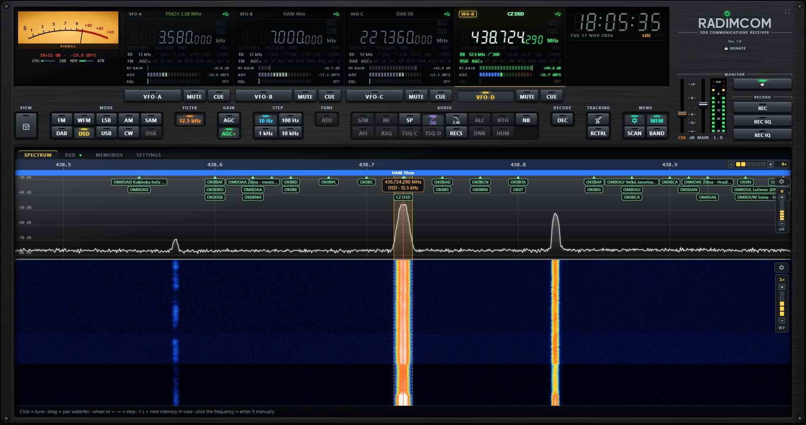
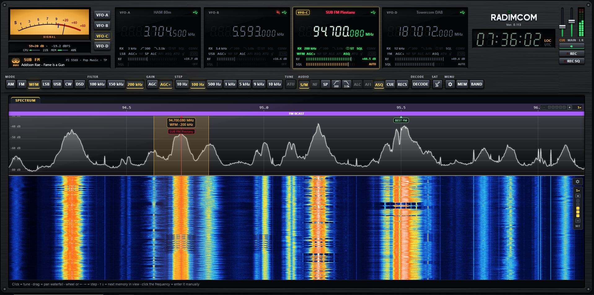
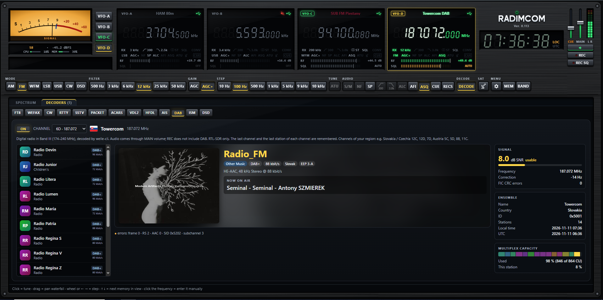

# RADIMCOM

A Windows receiver for RTL-SDR, LimeSDR Mini and Airspy R2, controlled from a web browser: up to four SDRs as four VFOs,
with a transceiver-style screen (S-meter, 7-segment displays, spectrum, waterfall, function keys) and built-in decoders.

What each part of the screen does: [annotated main screen](docs/images/main_annotated.png).

> [!NOTE]
> **A word from us.** Thank you for visiting our project – we really appreciate it. We are Radim and Brano,
> two radio amateurs, and RADIMCOM grew out of our years on the bands.
>
> It is not meant to be a receiver that can do absolutely everything. We built in what is close to us and what we
> enjoy: listening to the amateur bands, to air traffic, because we are aviation fans, and to other interesting
> bands as well. AI could surely help us
> build a huge number of tools to decode any unencrypted traffic out there, but that is not really our aim. Instead,
> RADIMCOM brings together the tools we used to run as separate applications over the years: the SDR itself,
> listening to amateur satellites with Doppler correction, the antenna rotor, weather radiosonde decoding and the like.
>
> It may not look like it at first glance, but we try hard to keep it friendly and understandable for less experienced
> listeners too – see for example the block diagram in SETTINGS › STATION, which shows where the signal goes.
>
> We test every kind of traffic on real signals on the air. Synthetic traffic is enough to write the code, but what
> matters is tuning it and proving it in the real world – that takes time and dedication, which we do not lack.
>
> Take RADIMCOM as our spare-time project that we build for the fun of it. We firmly believe it will bring you joy too,
> and that you will spend many pleasant moments with it. And we will be glad if, while playing with the receiver,
> you learn something new along the way. 73!

## Installation

RADIMCOM comes as one Windows setup, **`RADIMCOM_Setup_v<version>.exe`** (about 65 MB), from
[Releases](https://github.com/om2amr/RADIMCOM/releases). Python and all its packages are inside it: there is nothing to
install first, nothing is downloaded, and no administrator rights are needed.

1. **Run the setup.** It installs to `C:\RADIMCOM` (or a folder you choose) in English, Slovak or Czech.
   Windows SmartScreen may warn about an unsigned program: *More info* → *Run anyway*.
2. **Tick what you need:** the USB driver for your SDR (Zadig for RTL-SDR and Airspy, FTDI D3XX for LimeSDR),
   DSD-FME for digital voice ([DSD](docs/decoders/dsd.md)), a desktop shortcut, start with Windows.
3. **SDR setup:** at the end the connected dongles appear as cards; drag each onto VFO A–D, set ppm and the HF
   upconverter if you use one, SAVE. Later it is SETTINGS › SDR SOURCES in RADIMCOM (only the changed VFOs restart).
4. **RADIMCOM opens in its own window** with its icon on the taskbar (pin it there). Closing the window keeps the
   receiver running in the tray (decoders and recordings go on); *Exit RADIMCOM* in the tray menu, or the green LED
   of the logo (MAIN), switches it off. F11 toggles full screen.
   The page also works in any browser at **http://localhost:8434**, also from another PC on your network.

**System tray:** the RADIMCOM icon by the clock (under ˄ if Windows hides it; drag it out to keep it in view) stays
while the receiver runs, also with the window closed. Left click opens the window; right click has the menu:

| Menu item | What it does |
|---|---|
| Open RADIMCOM | brings the window up |
| Open in the web browser | the page in your default browser (http://localhost:8434) |
| Data folder | opens `data\` (settings, memories, logs, recordings) in Explorer |
| Server log | the log of the running server (`data\server_logs`), useful when something does not work |
| Start / Stop / Restart server | Stop frees the dongles (e.g. for another program) and RADIMCOM.exe stays in the tray; its window then offers START SERVER |
| Exit RADIMCOM | stops the receivers gracefully and closes everything |

With *start with Windows* ticked in the setup, RADIMCOM starts in the tray after login, without opening the window.

**Upgrade:** nothing to sort out by hand. The RADIMCOM setup is also the upgrade: run the newer one into the same
folder and it takes care of the rest. Your memories, VFO settings, logs and recordings live in the `data\` folder,
which the setup never overwrites (DSD-FME stays too); only the program itself is replaced.
RADIMCOM checks GitHub for a newer release and shows it beside the version under the logo, with *DOWNLOAD SETUP*;
exit RADIMCOM (tray menu) before you run it.

**From 0.114 or older (ZIP installation):** the old version also reports the new release, but it cannot upgrade itself
any more (there is no upgrade ZIP); instead of *UPGRADE* it offers *RELEASE PAGE*. Download the setup there, close the
RADIMCOM console window and install into the old folder. The setup recognizes the ZIP installation and turns it into
the RADIMCOM app; `data\` stays.

**Uninstall:** Windows Settings › Apps › RADIMCOM (it asks whether to delete `data\` too).

More: [Installation](docs/installation.md) (drivers, RADIMCOM.exe, running from the git sources).

## Supported hardware

| | RTL-SDR | RTL-SDR Blog V4 | LimeSDR Mini \* | Airspy R2 |
|---|---|---|---|---|
| Receive range | 24–1766 MHz | 0.5–1766 MHz (from 0.113) | 1–3500 MHz | 24–1750 MHz |
| Receiver bandwidth (sample rate) in RADIMCOM | up to 2.4 MS/s | up to 2.4 MS/s | up to 2.4 MS/s | 2.5 MS/s (fixed) |
| HF through an upconverter | yes | built-in upconverter, used by its driver below 28.8 MHz | yes | yes |
| Transmit | – | – | yes (optional, off by default) | – |
| All audio modes and FT8, WEFAX, CW, RTTY, SSTV, PACKET, POCSAG, ACARS | yes | yes | yes | yes |
| VDL2, DAB / DAB+, ISM | yes | yes | – | – |
| Driver | WinUSB (Zadig) | WinUSB (Zadig) | FTDI D3XX | WinUSB |

\* Tested with LimeSDR Mini v1.x.

Up to four SDRs at once, each assigned to a VFO by its serial number; one dongle can also serve several VFOs
([VFO chaining](docs/configuration.md#vfo-chaining-one-dongle-for-several-vfos)).

## Features

### Receiver

- **Up to four SDRs as four VFOs (A–D)**, or one dongle shared by several VFOs (chaining). → [Configuration](docs/configuration.md)
- **Modes** AM (and SAM, synchronous AM), FM, WFM (stereo + RDS), LSB, USB, CW, DAB and DSD, with notch, ALC, NB (noise blanker), HUM (mains hum filter), DNR (spectral noise reduction: WIENER or NR4, also under speech), NTH (quiet between words), TNF (tracking notches), APF (CW audio peak filter), BIN (binaural), audio LPF / HPF and AFI (voice inversion); automatic LSB / USB on ham bands, AM on shortwave broadcast bands. → [Function keys](docs/controls.md#function-keys)
- **Squelch with ASQ (auto squelch)**: the level follows the measured noise floor plus a margin; **CTCSS / DCS tone squelch** (TSQ-C / TSQ-D) in FM. → [AUDIO keys](docs/controls.md#function-keys)
- **AGC+**: tuner gain from the A/D and the band's noise floor (inspired by the auto gain of OnAir): **smart clipping** drives the A/D to its top by the mean clipping of 1 s, probes the next tuner step and returns at once when it clips too much, stops when more gain buys nothing, shows *why this gain*; tuned on real short-wave signals, better also on FM, DAB and airband AM. → [GAIN keys](docs/controls.md#function-keys)
- **ATU (autotune, experimental)**: a click on an AM signal moves the tuning onto its carrier, on an SSB signal the suppressed carrier goes onto the red line, snapped to a whole kHz (e.g. 14.265 MHz) or rounded to 100 Hz. → [TUNE keys](docs/controls.md#function-keys)
- **Shortwave (HF)** through an upconverter, always showing the real frequency. → [HF upconverter](docs/hf-upconverter.md)
- **Digital-mode decoders:** FT8 and WSPR (with maps of the stations heard, PC clock sync), WEFAX, CW, RTTY (terminal with tuning indicators: crossed ellipses, mini waterfall, eye), SSTV, PACKET (AX.25 1200 / 9600 Bd, APRS with map) and POCSAG (pagers, 512 / 1200 / 2400 Bd, error correction). → [DECODE](docs/controls.md#function-keys) · [POCSAG](docs/decoders/pocsag.md)
- **CW skimmer:** up to 16 Morse stations decoded at once with soft decisions (Viterbi, beam search), the operator's timing learnt (bug, straight key, Farnsworth), calls in the spectrum. → [CW](docs/decoders/cw.md)
- **Aircraft data link:** ACARS and VDL2 with CPDLC and ADS-C decoded to plain text and a map of the aircraft, and **HFDL** on HF (2.9–22 MHz, all channels of a band at once). → [Aircraft](docs/decoders/aircraft.md) · [HFDL](docs/decoders/hfdl.md)
- **AIS** ships on 161.975 / 162.025 MHz (own decoder, both channels at once) with a map of ships, base stations and aids to navigation. → [AIS](docs/decoders/ais.md)
- **Radiosondes** (weather balloons, 400–406 MHz): Vaisala RS41, Graw DFM, Meteomodem M10 / M20, LMS6-403, iMet-54, MRZ-N1 / MP3-H1, iMS-100 / RS-11G, MTS01 and CF-06 / HT03, decoded by the decoders of [rs1729](https://github.com/rs1729/RS), several sondes in the visible spectrum at once (MULTI); position, altitude, climb, temperature and humidity, burst and the flight path on a map with a prediction (+1/2/3 h, landing; GFS wind from Open-Meteo where the sonde has not flown), temperature / humidity / wind profile against altitude, the rotor can follow a sonde. → [SONDE](docs/decoders/sonde.md)
- **ADS-B** aircraft on 1090 MHz (own Mode S / ADS-B decoder) with a list, a map with tracks and the raw messages. → [ADS-B](docs/decoders/adsb.md)
- **Meteor scatter:** an own **MSK144** decoder (6 m / 2 m, no PC clock needed) and a **meteor counter on the GRAVES radar** (143.050 MHz): echoes per hour and day, a yearly chart with the meteor showers, aircraft echoes left out, POINT turns the rotor to GRAVES. → [MSK144](docs/decoders/msk144.md) · [METEORS](docs/decoders/meteors.md)
- **PRE-REC:** the last minute of IQ kept in RAM; Alt+click on the waterfall plays what was there, through the AUDIO chain of the VFO. → [PRE-REC](docs/controls.md#retro)
- **Remote RTL-SDR dongles over the network (rtl_tcp)**, e.g. several dongles on a Raspberry Pi, with an install script for the server and a SETTINGS › RTL_TCP SERVER page (link, CPU, power, dongles, restart, update); *by Brano*.
- **Network sources:** rtl_tcp dongles and **Airspy SpyServers** (also picked from the public Airspy directory; a click on the network icon pauses a SpyServer VFO). → [Configuration](docs/configuration.md#network-sources-rtl_tcp-and-spyserver)
- **DX cluster (DX key):** the spots of the last 30 minutes by HF / VHF / UHF, a click tunes the VFO, marks in the spectrum.
- **Propagation (PROP key):** space weather, the HF bands at the station for the next 24 h corrected by the ionosondes and by what FT8 / WSPR hear, Kiruna magnetogram, FT8 BAND TEST. → [Propagation](docs/propagation.md)
- **COMPOSITE map** (COM key): aircraft, ships and sondes from the decoders of all VFOs on one map, the same aircraft from more decoders joined, details and 6 hours of history; decoder maps with an animated precipitation radar and their view kept. → [COMPOSITE](docs/composite.md)
- **DAB / DAB+ radio**, **digital voice** (DMR, P25, D-Star, YSF, …; test version; AFC, talk group names, caller countries) and **ISM** 433 / 868 MHz devices (incl. Wireless M-Bus meters) with device cards, 24 h curves and a timeline. → [DAB](docs/decoders/dab.md) · [DSD](docs/decoders/dsd.md) · [ISM](docs/decoders/ism.md)
- **Satellite tracking:** passes, world map, Doppler correction and a K3NG rotor, no other program needed. → [Satellites](docs/satellites.md)
- **SUN NOISE:** G/T of the station measured on the Sun with the rotor (Y factor), and SUN SCAN to find and correct the pointing error of the rotor. → [Sun noise](docs/satellites.md)
- **Rotor control map:** click a place or a memory channel with a location (LAT / LON) and the rotor turns there; channels shown by their MEMORIES groups; beam sector on the map turns with the antenna; page SETTINGS connects the SAT tracker, memory recall, the map, the SONDE tracker or METEORS (GRAVES) to the rotor and holds the rotor controller. → [Rotor control](docs/satellites.md#rotor-control-map)
- **Scanner** (SCAN tab): memories, a frequency range or the FM broadcast band (FM BCAST, centred on each station) (all 2280 airband 8.33 kHz channels in ~4 s per pass at 1.536 MS/s), all channels in the band of the dongle checked at once from the spectrum; own squelch / ASQ / priority per channel, SKIP, LOCKOUT, carrier lockout, activity log with MP3 recordings, search & store, occupancy heatmap. → [SCAN](docs/controls.md#scan)
- **MP3 recording** (REC / REC SQ, also DAB) with a RECORDINGS tab to play the files in the browser, **REC IQ** of the whole band of the dongle to WAV (SDR# style), daily decoder logs, **HTTP API**, optional **TX with LimeSDR**. → [Configuration](docs/configuration.md)

### User interface

- **Transceiver-style screen** in brushed black anodized aluminium (other skins: black or light aluminium, mahogany, RAL paint): S-meter, recessed displays, 3D keys; every VFO is one dark display window with all its state (RF GAIN, ADC level and SQL bars), side by side, each waterfall keeps running. → [Controls](docs/controls.md)
- **SETTINGS › STATION:** a live block scheme of the whole receiver – each VFO from the antenna through the dongle, AGC+, filter, demodulator and audio to the speakers and the decoders, drawn from the real state. → [Controls](docs/controls.md)
- **Spectrum and waterfall** with 1×–64× zoom and a waterfall speed bar; tune by click, drag, mouse wheel or the wheel over a digit. → [Tuning](docs/controls.md#tuning)
- **Band plan on the frequency axis**, audio spectrum bubble, seven S-meter layouts. → [Tuning](docs/controls.md#tuning)
- **"What's new" window** on the first start of a new version, with the changes of that version.
- **Memories** with favourites, spectrum tags and a memory editor (groups with notes, decoder and recording at recall, import from SDR# / JSON / CSV, export). → [MEM](docs/controls.md#function-keys), [Memory editor](docs/controls.md#memory-editor)
- **CUE**: hear other VFOs while one is selected, with MAIN / CUE faders and a level meter; **MUTE** of each VFO silences just that one. → [Function keys](docs/controls.md#function-keys)
- **DECODERS**, **SATELLITES**, **MEMORIES** (memory list and memory editor) and **SETTINGS** tabs; SETTINGS has a **GENERAL** page (skins, S-meter, touchpad, location, antennas of the station with their range – ANT in the VFO window warns when the VFO is tuned outside the range of its antenna, the one rotor of the station) an **SDR SOURCES** page (the sources dragged onto VFO A–D; only the changed VFOs restart) and a **VFO** page (VFO-A … D keys joined to the settings of that VFO, its RX CHAIN from the antenna and the source on). → [Controls](docs/controls.md)

The complete feature list: [docs/features.md](docs/features.md).

## Screenshots

| | |
|---|---|
|  |  |
| WFM with stereo and RDS | DAB+ |
|  |  |
| Satellite map | VDL2 / CPDLC |
|  |  |
| [Scanner](docs/controls.md#scan) | [Rotor control map](docs/satellites.md#rotor-control-map) |
|  |  |
| [Memory editor](docs/controls.md#memory-editor) | Skins |

## Security

> [!WARNING]
> **Trusted network only, never expose RADIMCOM to the internet.** It has no login, and by default it listens on all
> network interfaces. See [SECURITY.md](SECURITY.md), which also explains how to report a vulnerability.

Transmitting (LimeSDR) is off by default and legal only with a valid licence, see [Transmitting](docs/configuration.md#transmitting-limesdr).

## Documentation

- [Installation and running](docs/installation.md)
- [Features](docs/features.md)
- [Shortwave (HF) with an upconverter](docs/hf-upconverter.md)
- [Controls](docs/controls.md)
- [Configuration](docs/configuration.md): `vfos.json`, chaining, setup, TX, EEPROM, SDR# import, HTTP API
- Decoders: [Aircraft data link](docs/decoders/aircraft.md) · [ADS-B](docs/decoders/adsb.md) · [HFDL](docs/decoders/hfdl.md) · [AIS](docs/decoders/ais.md) · [Radiosondes](docs/decoders/sonde.md) · [POCSAG](docs/decoders/pocsag.md) · [CW](docs/decoders/cw.md) · [DAB / DAB+](docs/decoders/dab.md) · [DSD](docs/decoders/dsd.md) · [ISM](docs/decoders/ism.md)
- [Satellite tracking](docs/satellites.md)
- [Development](docs/development.md): block diagram, files, `data\` folder, backup and upgrade
- [HTTP API](API/API.md) · [Change log](CHANGELOG.md)

## Contributing and support

- **Bugs and feature requests:** [issues](https://github.com/om2amr/RADIMCOM/issues/new/choose)
- **Questions and help with setup:** [Discussions](https://github.com/om2amr/RADIMCOM/discussions)
- **Contributing code:** [CONTRIBUTING.md](CONTRIBUTING.md) and the [Code of Conduct](CODE_OF_CONDUCT.md)
- **Contributors:** Brano ([brjanicek](https://github.com/brjanicek)) – the memory editor (0.113); ADS-B, ISM, DAB and DSD as modes (0.114);
  the radiosonde and POCSAG decoders (0.115); remote dongles over the network, rtl_tcp with a Raspberry Pi server (1.1)
- **Support the project:** RADIMCOM is open source and free, and it will stay that way. If you enjoy it,
  [buy us a coffee on Ko-fi](https://ko-fi.com/radimcom) ☕ – even the smallest contribution tells us our effort makes sense.
  The same from the app: **☕ DONATE** under the version below the logo.

## License

RADIMCOM is released under the [MIT License](LICENSE): provided "AS IS", without any warranty, and the author
accepts no liability. [NOTICE.md](NOTICE.md) has the radio transmission notice and lists the third-party components,
which keep their own licences, and where to get their source code.
