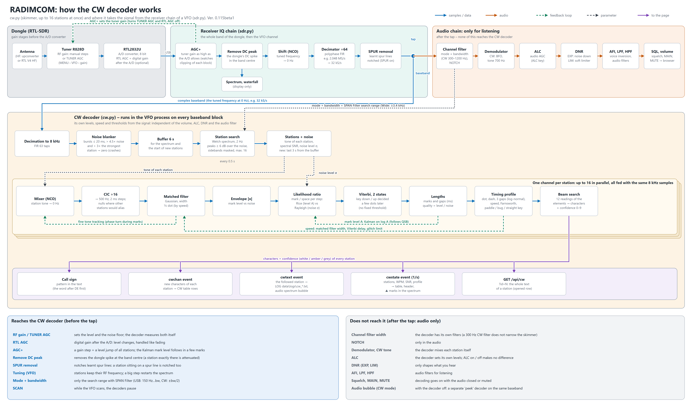

[← Documentation](../README.md)

# CW: Morse decoder and skimmer

The CW decoder (`cw.py`, numpy / scipy only) decodes Morse from the baseband of the VFO. It sets its own levels
and speed from the signal, so it does not depend on the ALC, the volume or the audio filter. It works in any mode;
in **CW** the VFO is tuned to the carrier, in USB / LSB it searches the passband.

Turn it on with **DEC → CW**, or with the **ON** key on the CW page of the DECODERS tab.

## The page

The CW decoder is always a **skimmer**: it decodes up to **16 stations at once** and lists them in a table that fills
the CW page. **SPAN**: *Filter* = search in the filter passband, *Wide* = ±3.4 kHz around the tuned frequency whatever
the filter (a CW filter of 500 Hz still lets you listen to one station while the skimmer reads the whole segment).

| Column | |
|---|---|
| **kHz** | frequency of the station |
| **CALL** | call sign found in its text (the word after DE first; by the call sign pattern, no database) |
| **WPM** | speed learnt from its keying (… while still learning) |
| **SNR** | its peak in the spectrum above the noise, dB |
| **TEXT** | the decoded text on one line, as much as the width of the tab takes; the newest characters at the right edge |

**Click a row** to open it: the whole text of the station (up to 4000 characters, wrapped; it scrolls inside when long
and can be selected and copied), under it **TUNE** (switches to CW and tunes the VFO to the station) and the
operator profile: frequency and tone offset, dot length, dah/dit ratio, the three gaps in dots, the key type
(*paddle* = keyer, *bug* = exact dots and loose dashes, *straight key* = everything loose) and for Farnsworth the letter
speed and the text speed. Click the row again (outside the text) to close it. Several rows can be open.

The text is coloured by confidence: white = sure, amber = uncertain, grey = guessed (several readings were possible,
or the marks were barely above the noise). Characters made only of noise blips are not written.

The **followed** station (amber row) is the strongest one automatically, or the one last opened; **AUTO** goes back to
the strongest. Its text goes to the **LOG** (`data\logs\cw_YYYY-MM-DD.txt`) and, in CW mode, to the audio spectrum
bubble; **TUNE** in the header tunes to it. **CLR** empties the table; stations still on the air come back within
half a second with empty text.

The stations are also marked at the bottom of the **spectrum**: a ▲ at the frequency with the call (or the speed
until a call is heard); the followed station is amber, the others blue, silent ones grey.

A new station first decodes the last 3 seconds from the buffer, so its first characters are not lost. A station silent
for 20 s leaves the table.

## How it works



The diagram also shows which receiver settings reach the decoder (RF gain, RTL AGC, AGC+, Remove DC, SPUR) and which only shape the audio (filter width, NOTCH, ALC, DNR, AFI / LPF / HPF, squelch).

1. **Decimation** to 8 kHz and a **noise blanker** (short bursts far above the noise and the strongest station are
   set to zero: static crashes).
2. **Station search**: Welch spectrum of the last 6 s (2 Hz resolution) in the band; peaks at least 6 dB above the
   median noise (more while the spectrum is still averaged over few segments) become stations, peaks closer than 40 Hz
   are one station. A peak within 80 Hz and 10 dB, or within 250 Hz and 20 dB, of a stronger one is the
   keying sideband or key click of that station, not another station; two channels that drift onto one station are merged.
3. **Channel** per station: mixed to 0 Hz, **CIC decimator** to 500 Hz (2 ms steps; its nulls lie exactly where the other
   stations would alias), **matched filter** (Gaussian, width a quarter of a dot, follows the speed), **fine tone
   tracking** from the phase turn during the marks (drifting or chirping stations).
4. **Soft decision**: the noise level comes from the spectrum (through the real noise gain of the filters), the mark
   level A from the decoded marks by a **Kalman filter** on log A; its uncertainty grows during the pauses, so after a
   fade weaker marks are still accepted. For every 2 ms step the **log likelihood ratio** mark / space is computed
   (Rice distribution with level A vs Rayleigh noise), and a **2-state Viterbi** decides the key state a few dots
   later, when all paths agree – instead of a fixed threshold with hysteresis.
5. **Timing model**: log-normal lengths of dot, dash, element gap, character gap and word gap, each learned
   separately from the elements decoded with high confidence. The first speed comes from splitting the marks into
   short and long; the gaps are re-fitted from the recent ones (the best split of the sorted lengths into 2 or 3
   groups), which finds Farnsworth spacing and slow fists.
6. **Characters**: a **beam search** keeps the 12 most likely readings of the elements (dot or dash, and element,
   character or word gap); a character is written when all likely readings agree on it. Its confidence is the share
   of the readings that agree times the level of its marks above the noise. A gap longer than the middle between the
   character and the word gap closes the word at once, so the last word is not kept waiting.

No language model and no call database are used yet: the decoder reads exactly what was keyed. Calls in the station
list are found by the call sign pattern (the word after DE first).

## Measured

`tests/cw_bench.py` generates CW (three texts each), adds noise and measures the **character error rate** (CER,
edit distance / text length; above 100 % = more garbage than text). SNR is the tone power to the noise power in
500 Hz. Comparison with the decoder of 0.114:

| Case | SNR | 0.114 | now |
|---|---|---|---|
| paddle 20 WPM | 6 / 0 / −3 dB | 2.6 / 9.1 / 204 % | 0 / 2.2 / 14 % |
| paddle 35 WPM | 6 / 0 / −3 dB | 23 / 71 / 108 % | 0 / 11 / 55 % |
| paddle 12 WPM | 6 / 0 / −3 dB | 2.6 / 6.5 / 117 % | 0 / 2.7 / 14 % |
| straight key 16 WPM (jitter 18 %) | 6 / 0 / −3 dB | 5.6 / 17 / 98 % | 1.2 / 5.4 / 40 % |
| bug 25 WPM | 6 / 0 / −3 dB | 8.9 / 46 / 94 % | 0.7 / 6.0 / 26 % |
| Farnsworth 20/10 WPM | 6 / 0 / −3 dB | 58 / 61 / 125 % | 3.0 / 7.7 / 25 % |
| QSB (fades to −16 dB) | 9 / 3 / 0 dB | 37 / 74 / 139 % | 37 / 39 / 48 % |
| static crashes 3/s | 6 / 0 / −3 dB | 2.6 / 19 / 133 % | 1.4 / 8.0 / 21 % |
| drift 40 Hz | 6 / 0 / −3 dB | 2.6 / 8.3 / 68 % | 0 / 1.3 / 15 % |
| neighbour 90 Hz away, −6 dB | 6 / 0 / −3 dB | 2.6 / 9.1 / 127 % | 0 / 2.2 / 14 % |
| **mean of all 70 cases** | | **50 %** | **19 %** |

Run it yourself (about 3 minutes):

```
python tests/cw_bench.py                    # the current decoder
python tests/cw_bench.py --old old_cw.py    # side by side with another version
python -m unittest tests.test_cw            # quick tests
```

Deep QSB stays hard: in the troughs the marks break up and no timing model can put them together again; the
characters from there are shown grey.
