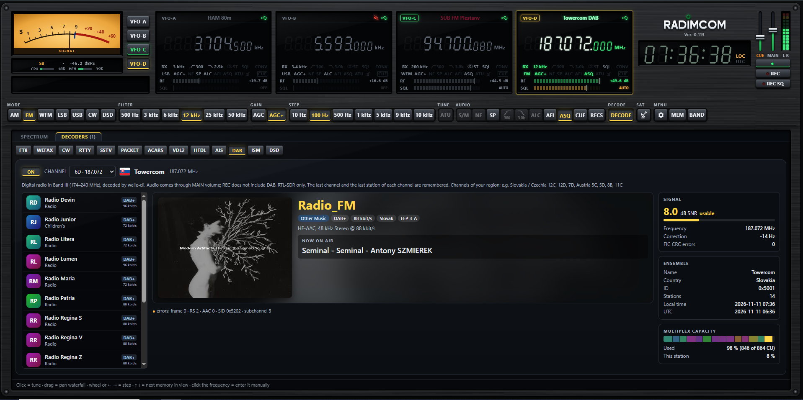
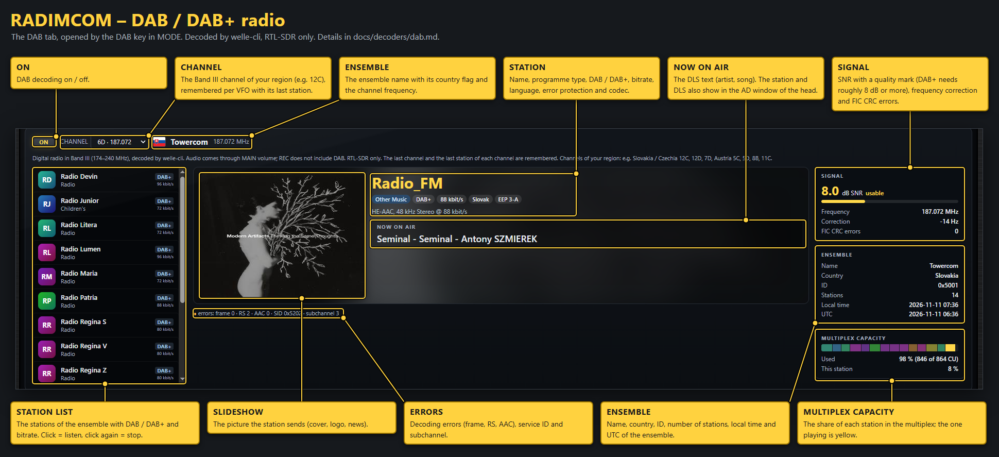

[← README](../../README.md) · [Documentation](../README.md)

# DAB / DAB+ digital radio

DAB and DAB+ are broadcast in Band III (174–240 MHz). One channel (e.g. 12C = 227.360 MHz) carries an ensemble
(multiplex) of many stations, 1.5 MHz wide.

- Press **DAB** in the MODE group. The VFO switches to 2.048 MS/s on the centre of the channel and the
  **DAB** tab (next to SPECTRUM, there only while the mode DAB is on) opens with the DAB+ card. Pick the channel of your region in CHANNEL (remembered per VFO,
  default 12C); after a few seconds the ensemble name with its country flag and the station list appear.
- Click a station to listen, click it again to stop. Each VFO remembers the last channel and the last station of each channel, and the station plays again by itself; after a reload of the page the browser may wait for the first click.
  Audio plays through MAIN volume; REC does not record DAB.
- The middle of the card shows the station: slideshow picture, programme type, DAB / DAB+, bitrate, language, error protection, codec, the DLS text ("now on air") and the decoding errors.
- The station playing is also in the **AD window** under the S-meter (in the place of RDS): DAB / DAB+ tag, station name, SNR in the colour of the signal quality and the DLS text, running when it is wider than the window. Errors and the rotor MONITOR have priority over it.
- The right side shows **SIGNAL** (SNR with a quality mark, frequency correction and FIC errors), **ENSEMBLE** (name, country, ID, stations, local time and UTC) and **MULTIPLEX CAPACITY** (the share of each station; the one playing is yellow).
- Another mode in MODE, any band button or recalling a memory that is not DAB ends DAB and restores the previous sample rate. DAB turns ACARS and
  VDL2 off (one dongle cannot be in two bands). RTL-SDR only; not on LimeSDR, Airspy or a chained VFO.
- No stations: the channel has no ensemble at your place, or the signal is weak. Use a vertical antenna for Band III,
  a manual RF gain (too much gain overloads the dongle) and check the SNR (DAB+ needs roughly 8 dB or more).

Decoding is done by [welle-cli](https://github.com/AlbrechtL/welle.io) (welle.io, GPLv2+, `lib\dab\welle-cli.exe`),
which runs as a separate program. The dongle stays in RADIMCOM: `dab.py` runs a local rtl_tcp server
(127.0.0.1, free port) and welle-cli connects to it like to a network dongle; its tuning requests retune the VFO.
The station list, DLS, slides and MP3 audio come from welle-cli's built-in web server and RADIMCOM passes them to
the browser (`/api/dab…`, see the HTTP API). welle-cli is built with MSYS2 UCRT64 by `installer\build_dab.sh`, with a small patch
(`installer\welle_radimcom.patch`: right audio speed on HE-AAC v2 stations);
licences, sources and build steps are in `installer\DAB.txt` (`lib\dab\README.txt` in the package).
