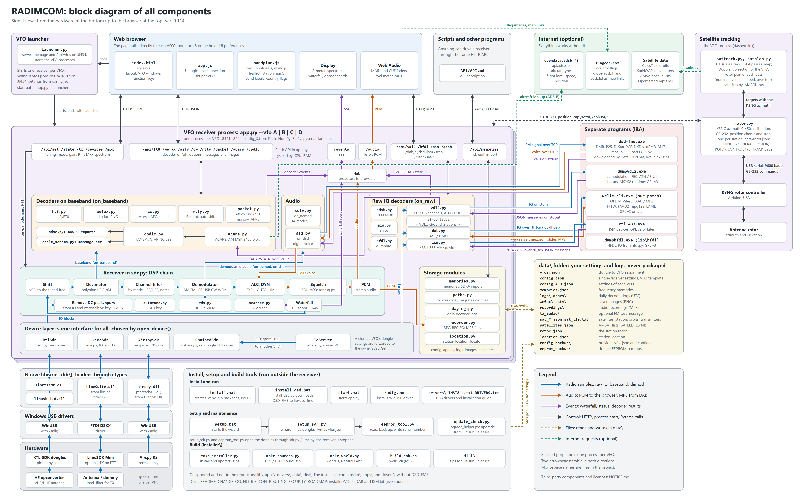

[← README](../README.md) · [Documentation](README.md)

# Development

## Block diagram

All components and how the signals flow between them, from the hardware at the bottom to the browser at the top:

## Files

| File | Contents |
|---|---|
| `app.py` | receiver server (Flask): API, events (SSE) and audio |
| `launcher.py` | VFO A–D launcher |
| `sdr.py` | RTL-SDR via librtlsdr (ctypes) and DSP: tuning, filters, demodulation, squelch, waterfall |
| `rds.py` | RDS decoder |
| `ft8.py`, `wefax.py`, `cw.py`, `rtty.py`, `sstv.py`, `acars.py`, `cpdlc.py`, `adsc.py` | decoders (`adsc.py`: ADS-C reports inside ACARS) |
| `packet.py`, `aprs.py` | PACKET decoder: AX.25 link layer, 1200 / 9600 Bd demodulators; APRS parse |
| `vdl2.py` | VDL2: runs `lib\vdl2\dumpvdl2.exe`, feeds it the raw samples, turns its messages into ACARS / CPDLC records |
| `hfdl.py` | HFDL: runs `lib\hfdl\dumphfdl.exe` with the HFDL channels inside the band of the VFO (from `lib\hfdl\systable.conf`), feeds it the raw samples, turns its messages into table rows |
| `ais.py` | AIS decoder: both channels (161.975 / 162.025 MHz) out of the raw samples (band-pass, polyphase decimation, FM, bit clock and HDLC of `packet.py`), message types 1–27, MMSI countries, NMEA |
| `ism.py` | ISM decoder: runs `lib\ism\rtl_433.exe`, gives it the raw samples through a local rtl_tcp server, reads its messages |
| `recorder.py` | audio recording to MP3 files in `data\recordings` (REC, REC SQ) |
| `rotor.py` | antenna rotor (K3NG, GS-232): position checks, azimuth calibration, the K3NG 0–450 azimuth |
| `satellites.py` | SATELLITES tab: the lists of active satellites from amsat.org, cleaned and cached |
| `sattrack.py` | SATELLITES tab: orbital elements from CelesTrak, station location and pass prediction (SGP4), transmitters from SatNOGS DB, Doppler correction |
| `satplan.py` | SATELLITES tab, TRACK: rotor plan of a pass (normal, overlap, flipped, over the top) and the tracker that follows it |
| `dsd.py` | DSD mode: runs `lib\dsd-fme\dsd-fme.exe`, feeds it the FM discriminator, plays its voice, follows the calls in its text output |
| `install_dsd.bat`, `install_dsd.py` | downloads DSD-FME into `lib\dsd-fme` (not in the package, patent notice) |
| `VDL2_Ground_Stations.txt` | VDL2 ground stations by address (airport, position and channel when known, city) for the Ground Station column. Source: [ACARS-VDL2 group](https://acars-vdl2.groups.io/), redistributed with approval. Thank you Sergi for amazing work. If you come across any new ground station that is not included in the list, please let us know. Thank you. |
| `airports.py` | IATA to ICAO and city tables for the VDL2 Ground Station column (OurAirports, public domain) |
| `cpdlc_schema.py` | CPDLC message set (generated data) |
| `CHANGELOG.md` | version history |
| `NOTICE.md` | radio transmission notice, third-party components and their licences |
| `API/API.md` | HTTP API description (control the receivers from scripts) |
| `daylog.py` | daily decoder logs |
| `memories.py` | memories and import from SDR# |
| `eeprom_tool.py` | reading, backing up and writing dongle EEPROM |
| `setup_sdr.py` | initial dongle setup wizard (`vfos.json`) |
| `iqshare.py` | VFO chaining: the owner VFO shares its dongle samples with chained VFOs |
| `lime.py` | LimeSDR via LimeSuite.dll (receive and transmit) |
| `airspy.py` | Airspy R2 via airspy.dll (receive) |
| `static/` | web interface (`index.html`, `style.css`, `app.js`) |
| `paths.py` | data paths (`data\`), migration of data from older versions |
| `installer/` | building the installer package (`make_installer.py`) and the files it contains; the package is created in `dist\` |
| `docs/block_diagram.py` | draws `docs/images/block_diagram.png` (needs Chrome or Edge) |

## Data folder (`data\`)

RADIMCOM keeps two kinds of files apart:

- **Program** (main folder): code, web interface, libraries. Same on every PC; comes from git or the installer package.
- **Your data** (`data\` folder): your settings, memories, logs, saved images and backups. Different on every PC.

`data\` is never uploaded to GitHub (it is in `.gitignore`) and never packed into the installer, so your
personal data stays only on your PC, and an update or reinstall of the program does not touch it.
The paths are defined in `paths.py`.

| File / folder | Contents | Created by |
|---|---|---|
| `config.json` | settings for single-receiver mode and template for new VFOs | installer (template), moved here at first start |
| `vfos.json` | dongle assignment to VFOs (serial numbers, ports) | `setup_sdr.py` / `setup.bat` |
| `config_A/B/C/D.json` | settings of each VFO (frequency, mode, filters, squelch, gain, ppm, …), saved on every change | launcher at first start, from `config.json` + `init` |
| `memories.json` | frequency memories (`memories.json.bak`: the file as it was before the first change by the memory editor) | MEM, import from SDR# |
| `memory_groups.json` | groups of the memories with their notes, and empty groups | MEMORIES tab → GROUPS |
| `logs\` | daily decoder logs `<decoder>_YYYY-MM-DD.txt` (UTC) | LOG checkbox in decoder cards |
| `acars\` | daily logs: classic ACARS `acars_YYYY-MM-DD.txt`, VDL2 `vdl2_YYYY-MM-DD.txt` (UTC) | ACARS / VDL2 with LOG on |
| `wefax\`, `sstv\` | saved WEFAX / SSTV images (PNG) | the decoders |
| `recordings\` | audio recordings (MP3) | REC, REC SQ |
| `config_backup\<date_time>\` | previous `vfos.json` and `config_X.json` | `setup_sdr.py` before writing a new assignment |
| `eeprom_backup\` | dongle EEPROM backups (`.bin`) | `eeprom_tool.py`, `setup_sdr.py` |
| `tx_audio\test_message.wav` | optional FM test message for TX | you (copy a WAV there) |

**Older versions** kept these files in the main folder. At the first start of a version with `data\` they are moved
there automatically (`paths.py`). A file is moved only if it is not in `data\` yet; an existing file in `data\` is
never overwritten (a leftover copy then stays unused in the main folder).

**Backup:** close the receiver first (it saves `config_X.json` while running), then copy or zip the whole `data\`
folder somewhere outside the RADIMCOM folder.

**Reinstall / update:**
- After each start RADIMCOM asks GitHub once whether a newer version is released. If so, a small window offers it:
  **UPGRADE** downloads the upgrade zip, closes the receiver, installs it in its own console window (unzips the program,
  runs `upgrade.bat`) and starts RADIMCOM again; the page reloads by itself. `data\` and the settings stay.
  **LATER** asks again at the next start, **SKIP THIS VERSION** not before a still newer one. The RADIMCOM logo turns red and an orange, blinking "0.1xx" shows beside the version under the logo;
  a click on either opens the release page in a new tab. Without internet nothing is shown. Off with
  `"update_check": false` in `data\vfos.json`. A development copy (a folder with `.git`) is not upgraded by itself.
- Unzipping a new installer package over the old folder keeps `data\` (the package has no `data\`).
- In a new, empty folder: copy the backed-up `data\` into it before the first start. For the DSD mode, run `install_dsd.bat` again.
- In `install.bat`, answer **N** to "Run the SDR setup now" to keep the existing VFO assignment; with Y a new
  assignment is created and the old one is moved to `data\config_backup\`.
- Do not run two RADIMCOM folders at the same time: they share the dongles and port 8434.
