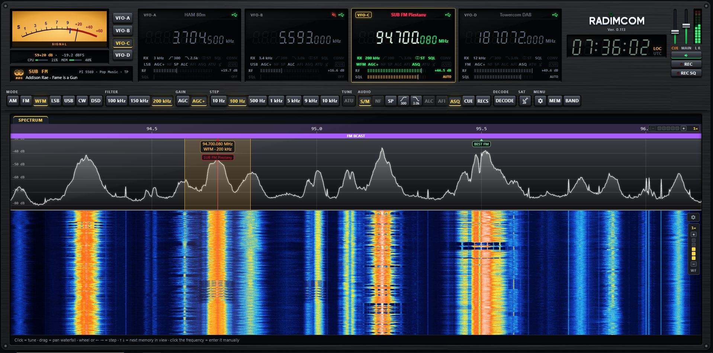

[← README](../README.md) · [Documentation](README.md)

# Features

## Receiver features

- **Up to four VFOs, A–D.** Each VFO has its own SDR (RTL-SDR, LimeSDR Mini or Airspy R2, selected by serial number)
  and its own settings.
- **Network sources:** an RTL-SDR dongle of an rtl_tcp server or an **Airspy SpyServer** (own client; a narrow band such as
  the 228 kHz of an HF+ upsampled), the public SpyServers to pick from the Airspy directory, a SpyServer VFO paused
  (disconnected) by a click on its network icon. See [Network sources](configuration.md#network-sources-rtl_tcp-and-spyserver).
- **SETTINGS › GENERAL › BACKUP:** back up the settings (VFO settings and sources, memories, station, satellites, ISM
  devices, map API keys, page settings) to a ZIP and restore them, e.g. on a new PC; a factory reset keeps a full backup in
  `RADIMCOM\backup\` first. See [BACKUP](controls.md#backup).
- **SETTINGS › SDR SOURCES:** the sources dragged onto VFO A–D in the running RADIMCOM; APPLY restarts only the VFOs that
  change, a VFO keeps its settings with its source. See [SDR SOURCES](configuration.md#sdr-sources-assigning-sources-to-vfos).
- **PROPAGATION tab (PROP key):** space weather (NOAA SWPC), the HF bands at the station for the next 24 h corrected by the
  GIRO ionosondes and by what FT8 / WSPR hear, the Kiruna magnetogram, FT8 BAND TEST. See [Propagation](propagation.md).
- **DX CLUSTER tab (DX key, group PROP):** the DX cluster spots of the last 30 minutes (HamQTH, no login) split into HF / VHF /
  UHF, with a filter; a click on a spot tunes the active VFO there with its mode, and the spots are marked in the spectrum.
  See [DX CLUSTER](propagation.md#dx-cluster).
- **VFO chaining:** one dongle can serve several VFOs, e.g. one dongle for VFO A–D, or two dongles with two VFOs
  each. A chained VFO listens anywhere inside the band its dongle receives and shows a green CHAIN flag
  (see [VFO chaining](configuration.md#vfo-chaining-one-dongle-for-several-vfos)).
- **Modes:** AM (with **SAM** – synchronous AM, DSB or one sideband, no distortion in selective fading), FM, WFM, LSB, USB and CW with selectable filter width, DAB (digital radio) and DSD (digital voice), each of these two with its own tab (see below). **Automatic LSB / USB:** tuning into another ham band in LSB or USB switches to its usual sideband (SETTINGS → GENERAL → TUNING, can be turned off).
- **WFM stereo** (19 kHz pilot, **ST** indicator) and **RDS**: station name (PS), RadioText, PI, PTY, TP/TA and clock (CT).
- **Squelch** for AM, FM and WFM, each mode with its own level. It decides every ~8 ms, so it does not cut off
  the start of a transmission (airband), and closes about 25 ms after the signal drops below the level. The level is marked on the S-meter with a yellow tick.
  - **ASQ (auto squelch):** the squelch level follows the noise in the channel plus a margin (6 dB by default, 2–30 dB in SET, AUDIO tab).
    The noise is measured in the spectrum of the dongle band, so a signal in the channel, even a long one, does not raise the level and close it.
    See [Function keys → AUDIO](controls.md#function-keys).
  - **Tone squelch TSQ-C (CTCSS) and TSQ-D (DCS)** in FM, in addition to the squelch level or ASQ: the audio passes only while the set
    sub-audio tone (50 standard tones 67.0–254.1 Hz) or DCS code (104 standard codes, N / I) is received; the tone is filtered out of what you hear.
    Shown in the VFO window under the frequency. See [Function keys → AUDIO](controls.md#function-keys).
- **AGC+ (smart gain, inspired by the auto gain of OnAir):** sets the tuner gain from the A/D converter and the spectrum of the band: AUTO with
  **smart clipping** (1.1beta2, tuned for hours on real short-wave signals, better also on FM broadcast, DAB and airband AM) drives the A/D
  to its top, judged by the mean clipping of the last second (0.1 %), probes the next tuner step and returns at once when it clips too much,
  climbs again when the band gets quieter, and stops climbing when more gain buys nothing (the noise floor far over the A/D's own); the most
  out of the RF signal while keeping the quality, together with NTH and DNR much more readable weak signals; a meter strip with a clip lamp,
  warnings and *why this gain*. With the squelch set, AGC+ switches it to auto squelch. A diagram beside its settings (SETTINGS › VFO › ADVANCED) shows where AGC+, each of its settings and the audio ALC work. See [Function keys → GAIN](controls.md#function-keys).
- **ATU (autotune), experimental,** in USB, LSB, AM and CW (zero beat onto the 700 Hz pitch): a click on a signal moves the tuning onto its carrier (AM within a few Hz in under 1 s);
  in SSB the suppressed carrier goes onto the red line, snapped to a whole kHz or rounded to 100 Hz (from the carrier-side edge of the voice band, ~2 s). See [Function keys → TUNE](controls.md#function-keys).
- **Audio processing:** automatic notch filter (NF), audio low-pass and high-pass filters (LPF / HPF; the LPF as steep as the channel filter), automatic audio level (ALC) with smooth gain and SLOW / FAST times (FAST by default), **DNR** – digital noise reduction (spectral, Wiener gain from minimum-statistics noise: the noise lowered also under speech, level 1–10), **HUM** – mains hum filter (narrow notches at 50 / 60 Hz and its multiples, only where the hum is, following the mains of the transmitter; no echo), **NB** – noise blanker (pulses blanked in the wideband samples before the channel filter, stations never), and **NTH** – noise threshold: an expander with a voice detector turns the noise between words down while the speech stays at full level (AUTO and FAST by default: it sets itself, opens sooner and does not drop in a word on weak signals), plus a soft limiter. DNR has two algorithms: **WIENER** and **NR4** (spectral bleaching, less music noise). **TNF** – tracking notch filters set by Shift+click on carriers in the spectrum, staying on them when the VFO is retuned; **APF** – CW audio peak filter (50 / 100 / 200 Hz at the 700 Hz pitch); **BIN** – binaural audio for headphones (CW, SSB, AM).
- **AFI (audio frequency inversion):** voice inversion scrambler / descrambler, inversion frequency 500–4000 Hz; REC and the decoders get the descrambled audio.
  See [Function keys → AUDIO](controls.md#function-keys).
- **Remove DC peak** and **remove spurs** from local sources, in the waterfall and in the received signal.
- **Upconverter:** HF is tuned via the LO (e.g. 100 MHz), see [Shortwave (HF) reception](hf-upconverter.md). For a VFO with a manual converter switch, crossing
  30 MHz shows a warning whether the converter must be switched on (CONV) or set to BYPASS.
- **Decoders:** 22 decoders, see [Decoders](#decoders) below.
- **Satellite tracking:** pass prediction, world map, Doppler correction of the VFO and a K3NG antenna rotor over USB, planned for passes across the north; no other program needed. The Moon for EME is one more "satellite" (own echo Doppler, path loss, rotor), see [The Moon (EME)](satellites.md#the-moon-eme). **SUN NOISE** measures the G/T of the station on the Sun with the rotor, see [Sun noise](satellites.md#sun-noise-gt). See [Satellite tracking](satellites.md).
- **ROTOR CONTROL tab (RCTRL key):** a map where a click (or a click on a channel of MEMORIES with a location) turns the rotor to that azimuth from the QTH, with the wanted azimuth (dashed line) and the antenna now (beam sector turning with the rotor), from any VFO; recalling a channel with a location opens the tab and turns the rotor to it; the channels are shown by their groups (a checkbox per group beside the map); page **SETTINGS** connects / disconnects the five sources of the wanted AZ / EL (SAT TRACKER, MEMORY RECALL, RCTRL MAP, SONDE TRACKER – the rotor follows the chosen radiosonde, AZ / EL from its GPS position and altitude, GRAVES – POINT on DECODERS › GRAVES) from the rotor in a block diagram (rotor block green = at least one connected) and holds the rotor controller itself (one rotor for the whole station, settings in `data\rotor.json`: ON / OFF, serial port, polar plot and elevation column with the antenna and its target, a click moves the antenna; STOP, RESET, MONITOR, azimuth calibration). See [Rotor control map](satellites.md#rotor-control-map).
- **REC and REC SQ:** record the audio of the selected VFO to MP3 files in `data\recordings` or an own folder (SETTINGS › GENERAL › RECORDINGS): everything, or only while the squelch is open; with DAB the MP3 of the station as it comes. The keys and REC in the VFO window blink while audio goes into the file.
- **PRE-REC:** the IQ of the dongle of the last 10–300 s (60 s default) kept in RAM; **Alt+click on the waterfall** plays
  that moment at that frequency (up to 20 s, with the mode, filter and all the AUDIO keys of the VFO, no squelch), **SAVE IQ** writes the whole
  buffer as an IQ WAV. See [PRE-REC](controls.md#retro).
- **REC IQ:** the whole IQ of the dongle (the full band at its sample rate) to WAV files as SDR# records them (I / Q stereo, 8 bit RTL-SDR / 16 bit LimeSDR and Airspy, centre frequency in the name and in an `auxi` chunk), subfolder `iq` of the recordings folder; opens in SDR#, SDR++, HDSDR. See [Volume](controls.md#function-keys).
- **IQ PLAYER** (IQ FILE… in the RECORDINGS tab, or ▶ at an IQ recording; idea by Dano OM1ATS): an IQ file plays through the current VFO as a virtual dongle – waterfall, demodulation and all the decoders, as if live. WAV of SDR# / SDR++ / HDSDR / RADIMCOM, HackRF / PortaPack `.C16` + `.TXT`, `.cu8` / `.cs8` / `.c16` / `.cf32`, SigMF; the centre from the file (its name, `auxi` chunk, `.TXT` or SigMF), the rate fitted to the VFO. PLAY opens the SPECTRUM tab; play / pause, seek, LOOP; **BACK TO VFO** returns to the dongle with the whole earlier setting. The VFO display shows a blue blinking **IQ** instead of the USB / network icon.
- **SCAN tab (SCAN key, MENU group): scanner** on one VFO. Every ~85 ms it measures all channels in the band of the dongle at once
  from the spectrum, the tuner moves only between windows; memories (ALL / FAVOURITES / group), a RANGE (FROM / TO / STEP / MODE / BW, presets
  such as airband 8.33 kHz) the spectrum shown (VIEW) or the FM broadcast band (FM BCAST: 88–108 MHz, lands on the centre of each station, RDS PS as the name); START / PAUSE / SKIP / LOCKOUT / ◀ ▶ / STOP; own squelch, own ASQ margin and priority
  per memory (ASQ FOR ALL by default); resume DELAY / CARRIER / TIME; priority look into other windows, carrier lockout; activity LOG (CSV),
  MP3 recording of each activity, search & store into a memory group, HEATMAP of the occupancy. See [MENU → SCAN](controls.md#scan).
- **RECORDINGS tab (RECS key):** the recorded files in a table (start, memory, frequency, mode, length, size), played in the browser; **RECS / SCAN RECS** choose the MP3 of REC / REC SQ or the MP3 of the scanner; NEXT plays the next older file, filter, delete. See [RECS](controls.md#function-keys).
- **Daily logs:** the LOG checkbox in each decoder card writes to `data\logs\<decoder>_YYYY-MM-DD.txt` (UTC, one line per message; WEFAX/SSTV log the names of saved images), classic ACARS to `data\acars\acars_YYYY-MM-DD.txt` and VDL2 to `data\acars\vdl2_YYYY-MM-DD.txt`.
- **TX with LimeSDR** (optional, off by default), see [Transmitting (LimeSDR)](configuration.md#transmitting-limesdr).
- **HTTP API:** everything the page does can be done from scripts, see [API/API.md](../API/API.md).
- **Windows setup and app:** `RADIMCOM_Setup_v<version>.exe` installs RADIMCOM with its own Python (no admin rights, no internet), the USB drivers and DSD-FME as options, and upgrades an installation in place (`data\` stays). **RADIMCOM.exe** shows the page in its own window with the RADIMCOM icon (pinnable to the taskbar) and keeps the server in the tray when the window closes; full screen (F11) and MAIN power switch in the green LED of the logo; the SDR setup is SETTINGS › SDR SOURCES (for a first start without a setup still in the same window: dongles → VFO A–D, IDENTIFY by unplugging, any RTL-SDR dongle renamed in its EEPROM). See [Installation](installation.md).
- **New version notice:** after each start RADIMCOM checks GitHub for a newer version and shows it with a link to its setup; run the setup into the same folder, `data\` and the settings stay. A red RADIMCOM logo shows that a newer version is available; a click on it opens the release page.
  See [Data folder](development.md#data-folder-data).

## Decoders

| Decoder | What it decodes | Details | SDR | More |
|---|---|---|---|---|
| **FT8** | FT8 on the HF ham bands (160–10 m); next to the table a **station map** (▲ by the locator in the messages, last 10 min … 24 h, list of stations with distance, our report as a coloured chip, faint WW locator grid, also in a new tab) | band buttons; the PC clock must be accurate (±1 s): its offset against NTP is shown with a SYNC key | all | [DECODE](controls.md#function-keys) |
| **MSK144** | Meteor scatter (WSJT-X MSK144) on 6 m, 2 m, 1.25 m and 70 cm: each ping decoded at once, no time slots, no PC clock | own decoder (LDPC + CRC-13), band keys, log, the same message in 10 s one row | all | [MSK144](decoders/msk144.md) |
| **GRAVES** | Echoes of the GRAVES radar (143.050 MHz): meteors counted per hour and day, head echoes, satellites identified from their orbital elements, aircraft looked up on adsb.fi | fine waterfall 1 Hz × 16 ms (±250 Hz … ±8 kHz, 10 s … 1 h), AFC, detail and sound of each echo (a satellite as a tone following its Doppler), marked echoes, weak echoes (FAST, SAT·TLE, SAT·LINES), 48 h and yearly charts with the showers, TUNE and rotor POINT to GRAVES, log | all (2 m) | [GRAVES](decoders/meteors.md) |
| **Q65 / JT65** | The slow weak-signal modes of WSJT-X: JT65 on HF and EME, Q65 for scatter and EME on 6 m and above | jt9 of WSJT-X 2.7.0, whole T/R periods from their UTC start (Q65 15–300 s, A–E; JT65 60 s, A–C), band keys, progress bar, PC clock with SYNC, log | all | [Q65 / JT65](decoders/q65.md) |
| **BPSK** | Telemetry of BPSK satellites at 1200–9600 Bd: AO-40 FEC of the FUNcube family (with the FUNcube-1 telemetry) and AX.25 (plain or G3RUH) | own decoder, finds the carrier within ±3 / 6 / 12 kHz and follows its Doppler, satellite keys, bytes of each frame, log | all | [BPSK](decoders/bpsk.md) |
| **WSPR** | WSPR beacons on 160 m – 6 m (2-minute cycles, down to about −28 dB); next to the table a **station map** like FT8 | via wsprd of WSJT-X 2.7.0; band keys, recording progress, PC clock offset with SYNC; stations also in PROPAGATION | all | [WSPR](decoders/wspr.md) |
| **WEFAX** | radio fax (DWD, Northwood…) | automatic format detection (LPM / IOC), slant correction (SLANT, ALIGN), AFC that retunes the VFO onto the signal, gallery of saved images | all | [DECODE](controls.md#function-keys) |
| **CW** | Morse skimmer: up to 16 stations in the passband (or ±3.4 kHz) decoded at once | soft decoder: matched filter, Kalman fading tracker, Viterbi keying, beam search over the readings; learns the operator's timing (paddle / bug / straight key, Farnsworth); table of the stations with calls and their text (a click opens the whole text and the operator profile), text coloured by confidence, stations in the spectrum; text also in the audio spectrum bubble | all | [CW](decoders/cw.md) |
| **RTTY** | Baudot | automatic shift 90–1000 Hz, speed 45.45 / 50 / 75 / 100 Bd and polarity; teletype-style terminal, tuning indicators CROSS / WF (click = tune) / BARS / EYE, known stations | all | [DECODE](controls.md#function-keys) |
| **NAVTEX** | maritime safety information (navigational and weather warnings, ice, SAR, forecasts) on **518 / 490 / 4209.5 kHz** and the HF MSI frequencies | own SITOR-B decoder (CCIR 476 FEC mode B) from the baseband in any mode: AFC on the 170 Hz tone pair within ±3 kHz, each character from its DX or RX copy; messages ZCZC … NNNN, frequency keys, filter, live text, LOG | all | [NAVTEX](decoders/navtex.md) |
| **SSTV** | colour images | 14 modes (Martin, Scottie, Robot, PD), VIS, automatic AFC and slant, gallery of saved images | all | [DECODE](controls.md#function-keys) |
| **PACKET** | AX.25 at 1200 Bd AFSK and 9600 Bd FSK / GFSK G3RUH (satellites) | APRS with a station list and map, spectrum and eye diagram | all | [DECODE](controls.md#function-keys) |
| **POCSAG** | pager messages at 512, 1200 and 2400 Bd (all at once, both polarities) | BCH correction of one or two wrong bits per codeword, numeric / alphanumeric guessed, MESSAGES / ADDRESSES views, filter by RIC, LOG | all | [POCSAG](decoders/pocsag.md) |
| **ACARS** | classic aircraft data link (131.725 MHz and others, AM, MSK 2400 bit/s) | FANS-1/A CPDLC and ADS-C decoded to plain text; MESSAGES / AIRCRAFT / MAP views (aircraft heard, aircraft with a known position) | all | [Aircraft data link](decoders/aircraft.md) |
| **VDL2** | VDL Mode 2, EU or US channels 136.100–136.975 MHz, all channels of the region at once | via dumpvdl2; CPDLC (FANS-1/A and European ATN), ADS-C, VDL2 ground station of each message with a filter; MESSAGES / AIRCRAFT / MAP views (aircraft list; map of aircraft from ADS-B, ADS-C and VDL2 XID positions, tracks, ground stations) | RTL-SDR only | [Aircraft data link](decoders/aircraft.md) |
| **HFDL** | aircraft data link on HF, **2.9–22 MHz**, 16 ground stations; all HFDL channels inside the band of the VFO at once | via dumphfdl; ACARS, positions, logons, frequency data; aircraft data from ADS-B with a map link; heard ground stations, table of stations and frequencies, band buttons | all (needs HF: V4, upconverter) | [HFDL](decoders/hfdl.md) |
| **SONDE** | radiosondes (weather balloons) on **400–406 MHz**: Vaisala RS41, Graw DFM, Meteomodem M10 / M20, LMS6-403, iMet-54, MRZ-N1 / MP3-H1, iMS-100 / RS-11G, MTS01, CF-06 / HT03 (type found by itself); **MULTI**: all sondes in the visible spectrum at once | decoders of rs1729 (lib\sonde, separate programs) fed with the baseband, TYPES to listen for, a bad GPS position dropped, IQ recording of the channel, MULTI with an FFT channelizer of the dongle samples (frequencies listed); RS41 Reed–Solomon correction and CRC of each block; serial, position, altitude, speed, direction, climb, RS41 temperature and humidity, satellites, battery, burst, distance / azimuth / elevation from the station; SONDES / MAP (flight path, balloon / parachute) (+ T / RH / wind speed profile against altitude with the wind direction beside it and altitude / time chart under it, the sonde chosen by hand, flight prediction +1/2/3 h and landing, with the GFS model wind from Open-Meteo where the sonde has not flown) / FRAMES views, automatic log data\logs\radiosonde (read back after a restart), HISTORY 1D / 7D in the table and on the map | all | [SONDE](decoders/sonde.md) |
| **AIS** | ships: position reports, static and voyage data, base stations, aids to navigation, SAR aircraft on **161.975 / 162.025 MHz** (both channels at once) | own decoder (GMSK 9600 Bd, no external program); country from the MMSI, MarineTraffic / VesselFinder links; MESSAGES / SHIPS / MAP views (ships turned to their heading, tracks), NMEA sentence, LOG | all | [AIS](decoders/ais.md) |
| **ADS-B** | aircraft on **1090 MHz**: ADS-B (DF17 / DF18: flight, category, position, altitude, speed, vertical rate, squawk, emergency) and Mode S replies (DF0 / 4 / 5 / 11 / 16 / 20 / 21) | own decoder (PPM 1 Mbit/s, CRC with bit correction, CPR positions; no external program); country from the ICAO address, distance and azimuth from the QTH, globe.adsb.fi / adsb.lol links; AIRCRAFT / MAP / MESSAGES views, LOG | all (2.4 MS/s; Airspy 2.5 MS/s) | [ADS-B](decoders/adsb.md) |
| **DAB / DAB+** | digital broadcast radio in Band III | via welle-cli: station list of the ensemble, DLS text with a history of the songs (data\dab_history\), slideshow, audio, signal, ensemble and capacity panels, remembered channel and station, DAB on the VFO display and the DAB key blink while the station buffers | RTL-SDR only | [DAB / DAB+](decoders/dab.md) |
| **DSD** (first test version) | digital voice: DMR, P25, D-Star, YSF, NXDN, dPMR, M17 and more | the **DSD** key in MODE, via DSD-FME; calls on air as cards, list with talk group names, country of the caller ID and the callsign from the alias, TALK GROUPS heard, AFC onto the signal, filter width, DEBUG output; **separate download: run `install_dsd.bat`** | all | [DSD](decoders/dsd.md) |
| **ISM** | devices on 433 and 868 MHz: weather sensors, remote controls, tyre sensors, Wireless M-Bus meters (868.95 MHz); messages, device cards with 24 h curves, timeline, categories | via rtl_433 | RTL-SDR only | [ISM](decoders/ism.md) |

ACARS and VDL2 messages show the aircraft type, flight level, speed and squawk from adsb.fi / adsb.lol (emergency squawks 7500, 7600, 7700 framed in red)
and the country flag from the ICAO address; a click on a message pauses the list. Every decoder card has a LOG checkbox for a daily log.

### Decoder maps

The maps of FT8, WSPR, PACKET, ACARS / VDL2, HFDL, ADS-B, AIS and SONDE keep their **view** (centre and zoom, per map, in the
browser): it comes back after a switch of the VFO or tab and after a reload, and new data no longer fits the map to the
marks again. A click on a mark, or on its label (call, flight, serial), opens its **bubble** (dark, in the style of the page) and draws a **red dotted line from
the QTH** to it: on FT8, WSPR and SONDE to the selected station / sonde (the distance and azimuth in its bubble), on
PACKET, ACARS / VDL2, HFDL, AIS and ADS-B to the mark whose bubble is open, with the distance and azimuth in the middle
of the line, following a moving plane or ship until the bubble closes. The VDL2, HFDL, ADS-B and SONDE maps have switches in the top right corner (the COMPOSITE map has its own
[map settings](composite.md#map-settings)):

- **Precipitation:** the RainViewer radar (no position sent, only the map tiles), the last 30 minutes as an animation
  (frames every 10 minutes, the newest held a moment; its time in the bottom left corner with an opacity slider,
  10–100 %, 60 % by default, remembered per map), refreshed every 5 minutes; sharp up to zoom 7. Off by default.
- **Trails** (aircraft maps): the tracks of the aircraft on / off. On by default.

### COMPOSITE

**COM** key (group DECODE): one map with the positions from the decoders of **all VFOs** (ADS-B, ACARS / VDL2, HFDL, AIS,
SONDE), sources to pick, the same aircraft from more VFOs / decoders joined into one (ICAO, registration, flight number in
IATA / ICAO form, uncommon squawk), details of the selected aircraft, ship or sonde on the right with all its sources,
6 hours of history kept over a server restart, also in a new tab, the merged feed as JSON. See [COMPOSITE map](composite.md).

## UI features

- **Transceiver-style screen:** 7-segment frequency displays, function keys and band buttons (the **BAND** key hides the row of band buttons).
- **Skins** (SET → SKINS): dark, black or light brushed aluminium, mahogany, or a panel sprayed in a RAL colour (or any colour). See [SET](controls.md).
- **S-meter in seven layouts** (amber needle by default, needle, bar graph, LED bar, VFD display, 7-segment, peak bar), with the squelch level marked.
  Under it small bars show the CPU load and memory use of the PC.
- **All VFOs side by side:** the active VFO is lit, inactive ones are grey
  but show the actual tuned frequency. The waterfall of every VFO keeps running, so its history is visible
  right after switching. With fewer than four SDRs the remaining VFO windows stay in place, greyed out ("NO SDR").
- **Each VFO is one dark display window:** on top the name of the memory on its frequency, otherwise the band plan label
  (e.g. `HAM 70cm`) or the satellite transponder, lit on the active VFO (a memory name in its own tag colour); the receiver state, recording and mute indicators;
  the frequency; an info row (RX/TX, filter width, HPF and LPF with cutoffs, ST, SQL, CONV/BYPASS); a tone squelch row (CTCSS / DCS); annunciators lit like LCD segments (mode, AGC / AGC+, NF, SP, ALC, AFI, ASQ, ATU, satellite Doppler, CUE);
  **RF GAIN, ADC and SQL segment bars** (RF GAIN and SQL: drag, click or mouse wheel; at a manual RF gain the RF bar and its value turn red while the A/D converter clips; ADC: the A/D level in dBFS on a scale in the AGC+ colours – green at the headroom target, amber too hot, red clipping, blue too quiet). See [VFO window](controls.md#vfo-window).
- **Spectrum and waterfall** with 1×–64× zoom (the waterfall keeps the history of the whole band, so after zooming out the hidden parts are shown at once) and a waterfall speed bar (1/8 – 4×) and waterfall settings under a gear (colour scheme, range, offset), the same gear and bar by the spectrum (zero level −20 … +20 dB, colour schemes background / curve); tuning by a click, dragging the passband (dragging the band moves the view, the tuned frequency stays until it reaches the edge), the mouse wheel or the wheel over a digit of the display. See [Tuning](controls.md#tuning).
- **Band plan on the frequency axis** (Europe / ITU Region 1: ham, broadcast, aviation, marine, satellites, mobile networks, ISM…); hover it for the descriptions of all bands at that frequency.
- **Audio spectrum bubble:** hovering over the passband label shows the audio spectrum of the active VFO (in WFM the MPX signal with the stereo pilot, in CW also the decoded text).
- **Frequency memories** (MEMORIES tab) with groups, favourites, import from SDR# (`frequencies.xml`), JSON and CSV, export to JSON and CSV; memories in view show as tags in the spectrum,
  ↑ ↓ arrow keys recall the next one. A memory can also be a DAB channel (mode DAB) or a DSD (digital voice) channel.
- **Memory editor** (pages of the MEMORIES tab; by Brano, [brjanicek](https://github.com/brjanicek)): channels in several groups, with a decoder and a recording (REC, REC SQ or REC SQ with ASQ) started at recall, a note and their own tag colour
  (or no tag); groups with notes (add, rename, copy, merge, delete); duplicates shown; import from SDR#, JSON or CSV and export to
  JSON or CSV, both through a list to edit and choose from first. See [Memory editor](controls.md#memory-editor).
- **☕ DONATE** under the version below the logo (and in the "What's new" window): a few words about the project and a key to our [Ko-fi page](https://ko-fi.com/radimcom); RADIMCOM stays free.
- **Audio** starts automatically when the page opens and comes from the active VFO.
- **CUE:** keep listening to other VFOs at a separate CUE level while one VFO is selected;
  MAIN and CUE volume faders with a dB scale, stereo level meter with peak hold and CLIP LEDs, MUTE; a MUTE key of each VFO
  (red LED, between its VFO and CUE keys) silences just that VFO in the browser.
- **DECODERS tab** with a page for each decoder, and the **SATELLITES** tab (also the **SAT** key), which shows the active linear, FM, image and other satellites from AMSAT, with clickable links.
- **AD (additional display)** under the S-meter: error messages (red, accepted by OK, the frame blinks), the rotor AZ / EL (MONITOR), DAB now on air (station, SNR, running DLS text) or RDS, by this priority.
- **DEFAULT keys** by each group of adjustable values (AGC+, DC peak, SP, S9, HPF / LPF, AFI, DNR, ASQ margin, wheel speed, waterfall colours, scan options) set them back to their defaults.
- **SETTINGS tab** (gear key) split into **GENERAL** (the whole station: SKINS, S-METER, TUNING (touchpad speed, automatic LSB / USB on ham bands, AM on shortwave broadcast bands), LOCATION – station locator or latitude / longitude, also chosen on a map, used by the satellites, packet, HFDL and AIS; ANTENNAS – the antennas of the station with their frequency range, each VFO picks its antenna and ANT in the VFO window turns amber outside its range; RECORDINGS – the folder; SPOTS – FT8 to PSK Reporter and WSPR to WSPRnet; BACKUP – the settings of the station to a ZIP and back, factory reset), **SDR SOURCES** (the sources dragged onto VFO A–D), **VFO** (keys VFO-A … VFO-D on the left, the lit one joined to its card: RX CHAIN with a block diagram of the receive chain and the source, ADVANCED with SP, AGC+ (smart clipping and LINEARITY) and the S9 calibration, AUDIO, TX), **RTL_TCP SERVER**, **DATA/LOG** (logs and data files), **DEBUG** (where RADIMCOM spends its time, as text to copy; see [DEBUG](controls.md#debug)) and **STATION** (a live scheme of the whole receiver: QTH, rotor, Doppler, audio, and one row per VFO from the antenna through the dongle, gain with the AGC+ loop, filter, demodulator and audio blocks to the output and the decoders); **MEMORIES tab** (MEM key) with the pages CHANNELS (also the list to recall from), GROUPS, IMPORT, EXPORT.
- **Clock** in local time or UTC (a click switches), with the date under it.
- **The page scales with the browser window** (laid out for at least 1920 × 820 px), so the layout does not reflow in small windows.

