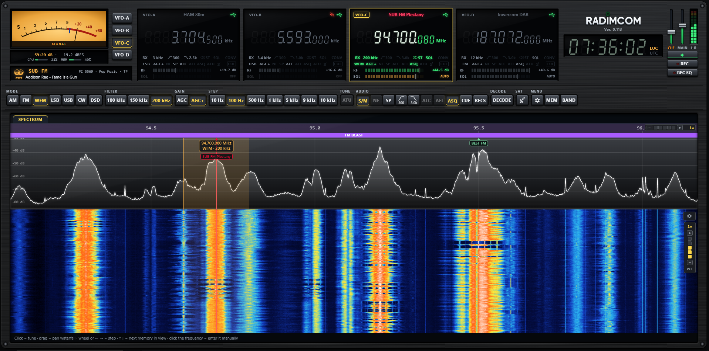

[← README](../README.md) · [Documentation](README.md)

# Features

## Receiver features

- **Up to four VFOs, A–D.** Each VFO has its own SDR (RTL-SDR, LimeSDR Mini or Airspy R2, selected by serial number)
  and its own settings.
- **VFO chaining:** one dongle can serve several VFOs, e.g. one dongle for VFO A–D, or two dongles with two VFOs
  each. A chained VFO listens anywhere inside the band its dongle receives and shows a green CHAIN flag
  (see [VFO chaining](configuration.md#vfo-chaining-one-dongle-for-several-vfos)).
- **Modes:** AM, FM, WFM, LSB, USB and CW with selectable filter width, and DSD for digital voice (see below).
- **WFM stereo** (19 kHz pilot, **ST** indicator) and **RDS**: station name (PS), RadioText, PI, PTY, TP/TA and clock (CT).
- **Squelch** for AM, FM and WFM, each mode with its own level. It decides every ~8 ms, so it does not cut off
  the start of a transmission (airband), and closes about 25 ms after the signal drops below the level. The level is marked on the S-meter with a yellow tick.
  - **ASQ (auto squelch):** the squelch level follows the noise in the channel plus a margin (6 dB by default, 2–30 dB in SET, AUDIO tab).
    The noise is measured in the spectrum of the dongle band, so a signal in the channel, even a long one, does not raise the level and close it.
    See [Function keys → AUDIO](controls.md#function-keys).
- **AGC+ (smart gain):** sets the tuner gain from the level of the A/D converter, as high as possible without clipping it,
  also with strong signals outside the channel. With the squelch set, AGC+ switches it to auto squelch. See [Function keys → GAIN](controls.md#function-keys).
- **ATU (autotune), experimental,** in USB, LSB and AM: a click on a signal moves the tuning onto its carrier (AM within a few Hz in under 1 s);
  in SSB the edge of the voice band goes onto the red line (USB lower edge, LSB upper edge, ~2 s). See [Function keys → TUNE](controls.md#function-keys).
- **Audio processing:** automatic notch filter (NF), audio low-pass and high-pass filters (LPF / HPF), automatic audio level (ALC).
- **AFI (audio frequency inversion):** voice inversion scrambler / descrambler, inversion frequency 500–4000 Hz; REC and the decoders get the descrambled audio.
  See [Function keys → AUDIO](controls.md#function-keys).
- **Remove DC peak** and **remove spurs** from local sources, in the waterfall and in the received signal.
- **Upconverter:** HF is tuned via the LO (e.g. 100 MHz), see [Shortwave (HF) reception](hf-upconverter.md). For a VFO with a manual converter switch, crossing
  30 MHz shows a warning whether the converter must be switched on (CONV) or set to BYPASS.
- **Decoders:** 11 decoders, see [Decoders](#decoders) below.
- **Satellite tracking:** pass prediction, world map, Doppler correction of the VFO and a K3NG antenna rotor over USB, planned for passes across the north; no other program needed. See [Satellite tracking](satellites.md).
- **REC and REC SQ:** record the audio of the selected VFO to MP3 files in `data\recordings`: everything, or only while the squelch is open.
- **Daily logs:** the LOG checkbox in each decoder card writes to `data\logs\<decoder>_YYYY-MM-DD.txt` (UTC, one line per message; WEFAX/SSTV log the names of saved images), classic ACARS to `data\acars\acars_YYYY-MM-DD.txt` and VDL2 to `data\acars\vdl2_YYYY-MM-DD.txt`.
- **TX with LimeSDR** (optional, off by default), see [Transmitting (LimeSDR)](configuration.md#transmitting-limesdr).
- **HTTP API:** everything the page does can be done from scripts, see [API/API.md](../API/API.md).
- **Upgrade from the page:** after each start RADIMCOM checks GitHub for a newer version and can download and install it; `data\` and the settings stay. A red RADIMCOM logo shows that a newer version is available; a click on it opens the release page.
  See [Data folder](development.md#data-folder-data).

## Decoders

| Decoder | What it decodes | Details | SDR | More |
|---|---|---|---|---|
| **FT8** | FT8 on the HF ham bands (160–10 m) | band buttons; the PC clock must be accurate (±1 s) | all | [DECODE](controls.md#function-keys) |
| **WEFAX** | radio fax (DWD, Northwood…) | automatic format detection (LPM / IOC), slant correction (SLANT, ALIGN), AFC that retunes the VFO onto the signal, gallery of saved images | all | [DECODE](controls.md#function-keys) |
| **CW** | Morse | AFC, speed estimation, noise blanker; text also in the audio spectrum bubble | all | [DECODE](controls.md#function-keys) |
| **RTTY** | Baudot | automatic shift 90–1000 Hz, speed 45.45 / 50 / 75 / 100 Bd and polarity | all | [DECODE](controls.md#function-keys) |
| **SSTV** | colour images | 14 modes (Martin, Scottie, Robot, PD), VIS, automatic AFC and slant, gallery of saved images | all | [DECODE](controls.md#function-keys) |
| **PACKET** | AX.25 at 1200 Bd AFSK and 9600 Bd FSK / GFSK G3RUH (satellites) | APRS with a station list and map, spectrum and eye diagram | all | [DECODE](controls.md#function-keys) |
| **ACARS** | classic aircraft data link (131.725 MHz and others, AM, MSK 2400 bit/s) | FANS-1/A CPDLC and ADS-C decoded to plain text | all | [Aircraft data link](decoders/aircraft.md) |
| **VDL2** | VDL Mode 2, EU or US channels 136.100–136.975 MHz, all channels of the region at once | via dumpvdl2; CPDLC (FANS-1/A and European ATN), ADS-C, VDL2 ground station of each message with a filter | RTL-SDR only | [Aircraft data link](decoders/aircraft.md) |
| **DAB / DAB+** | digital broadcast radio in Band III | via welle-cli: station list of the ensemble, DLS text, slideshow, audio, signal, ensemble and capacity panels, remembered channel and station | RTL-SDR only | [DAB / DAB+](decoders/dab.md) |
| **DSD** (first test version) | digital voice: DMR, P25, D-Star, YSF, NXDN, dPMR, M17 and more | the **DSD** key in MODE, via DSD-FME, list of calls; **separate download: run `install_dsd.bat`** | all | [DSD](decoders/dsd.md) |
| **ISM** | devices on 433 and 868 MHz: weather sensors, remote controls, tyre sensors | via rtl_433 | RTL-SDR only | [ISM](decoders/ism.md) |

ACARS and VDL2 messages show the aircraft type, flight level, speed and squawk from adsb.fi / adsb.lol (emergency squawks 7500, 7600, 7700 framed in red)
and the country flag from the ICAO address; a click on a message pauses the list. Every decoder card has a LOG checkbox for a daily log.

## UI features

- **Transceiver-style screen:** 7-segment frequency displays, function keys and band buttons (the **BAND** key hides the row of band buttons).
- **Skins** (SET → SKINS): dark, black or light brushed aluminium, mahogany, or a panel sprayed in a RAL colour (or any colour). See [SET](controls.md).
- **S-meter in seven layouts** (needle, bar graph, LED bar, VFD display, amber needle, 7-segment, peak bar), with the squelch level marked.
  Under it small bars show the CPU load and memory use of the PC.
- **All VFOs side by side:** the active VFO is lit, inactive ones are grey
  but show the actual tuned frequency. The waterfall of every VFO keeps running, so its history is visible
  right after switching. With fewer than four SDRs the remaining VFO windows stay in place, greyed out ("NO SDR").
- **Each VFO is one dark display window:** on top the name of the memory on its frequency, otherwise the band plan label
  (e.g. `HAM 70cm`) or the satellite transponder, lit on the active VFO (a memory name in its own tag colour); the receiver state, recording and mute indicators;
  the frequency; an info row (RX/TX, filter width, HPF and LPF with cutoffs, ST, SQL, CONV/BYPASS); annunciators lit like LCD segments (mode, AGC / AGC+, NF, SP, ALC, AFI, ASQ, ATU, satellite Doppler, CUE);
  **RF and SQL segment bars** (drag, click or mouse wheel). See [VFO window](controls.md#vfo-window).
- **Spectrum and waterfall** with 1×–32× zoom (the waterfall keeps the history of the whole band, so after zooming out the hidden parts are shown at once) and a waterfall speed bar (1/8 – 4×) and waterfall settings under a gear (colour scheme, range, offset); tuning by a click, dragging the band or the passband, the mouse wheel or the wheel over a digit of the display. See [Tuning](controls.md#tuning).
- **Band plan on the frequency axis** (Europe / ITU Region 1: ham, broadcast, aviation, marine, satellites, mobile networks, ISM…); hover it for the descriptions of all bands at that frequency.
- **Audio spectrum bubble:** hovering over the passband label shows the audio spectrum of the active VFO (in WFM the MPX signal with the stereo pilot, in CW also the decoded text).
- **Frequency memories** (MEMORIES tab) with groups, favourites, import from SDR# (`frequencies.xml`), JSON and CSV, export to JSON and CSV; memories in view show as tags in the spectrum,
  ↑ ↓ arrow keys recall the next one. A memory can also hold a DAB channel.
- **Memory editor** (pages of the MEMORIES tab; by Brano, [brjanicek](https://github.com/brjanicek)): channels in several groups, with a decoder and a recording (REC, REC SQ or REC SQ with ASQ) started at recall, a note and their own tag colour
  (or no tag); groups with notes (add, rename, copy, merge, delete); duplicates shown; import from SDR#, JSON or CSV and export to
  JSON or CSV, both through a list to edit and choose from first. See [Memory editor](controls.md#memory-editor).
- **Audio** starts automatically when the page opens and comes from the active VFO.
- **CUE:** keep listening to other VFOs at a separate CUE level while one VFO is selected;
  MAIN and CUE volume faders, stereo level meter, MUTE.
- **DECODERS tab** with a page for each decoder, and the **SATELLITES** tab (also the **SAT** key), which shows the active linear, FM, image and other satellites from AMSAT, with clickable links.
- **AD (additional display)** under the S-meter: error messages (red, accepted by OK, the frame blinks), the rotor AZ / EL (MONITOR) or RDS, by this priority.
- **Rotor page** in SETTINGS: ON / OFF per VFO, polar plot and elevation column 0–180° with the antenna and its target, a click moves the antenna; STOP, RESET, MONITOR.
- **SETTINGS tab** (gear key) with pages SDR DONGLE (BASIC, ADVANCED with the list of dongles and their VFOs), AUDIO, UI (SKINS, S-METER, TOUCHPAD), ROTOR, TX; **MEMORIES tab** (MEM key) with the pages CHANNELS (also the list to recall from), GROUPS, IMPORT, EXPORT.
- **Clock** in local time or UTC (a click switches).
- **The page scales with the browser window** (laid out for at least 1920 × 820 px), so the layout does not reflow in small windows.

