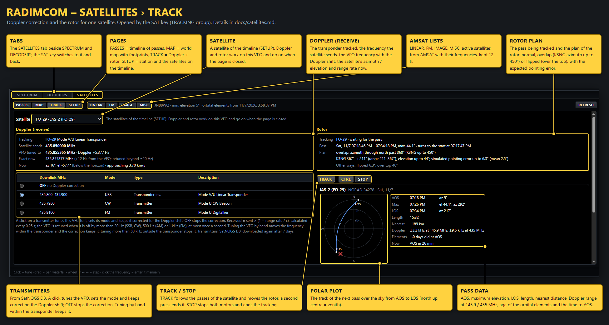
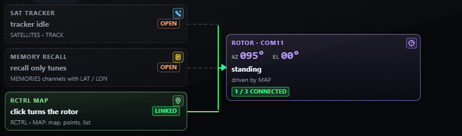

[← README](../README.md) · [Documentation](README.md)

# Satellite tracking

RADIMCOM predicts the passes, shows them on a timeline and a world map, keeps the VFO on the downlink (Doppler correction, receive
only) and moves a K3NG antenna rotor, all in the **SATELLITES** tab, with no other program. The **SAT** key switches to this tab and back. Positions are calculated with
SGP4 (Python package `sgp4`). The station, the satellites and the downloaded data are shared by all VFOs; the Doppler correction
and the rotor work on one VFO each and go on with the page closed.

## Pages of the SATELLITES tab

| Page | What it does |
|---|---|
| **PASSES** | Timeline of the passes of the chosen satellites over the next 12, 24 or 48 hours, and a list of them. A click on a pass shows its track on a polar plot, the elevation over time, the nearest distance, the Doppler shift at 145.9 and 435 MHz, the position now while it is on, and the transmitters of the satellite. |
| **MAP** | World map (Natural Earth, works offline) with the satellites switched on by the keys above it (up to 20): each with its footprint (yellow while it is above our horizon), the night side and the station. A click on a key or a dot chooses the satellite whose ground track is drawn (half an orbit behind, one ahead); beside the map are its position, altitude, azimuth and elevation from here, distance, Doppler shift, the next pass and its transmitters, and **TRACK** opens it on the TRACK page. Moves every second. |
| **TRACK** | Doppler correction and the rotor for one satellite of the timeline, below. |
| **SETUP** | The station location (shown here; it is set in **SETTINGS › GENERAL › LOCATION**: locator or latitude and longitude, CHOOSE ON MAP, altitude; **LOCATION…** opens it), the lowest highest-elevation of a pass shown, and the satellites on the timeline, chosen in tabs by CelesTrak group: Amateur Radio, Weather, CubeSats, Space & Earth Science, Galileo, GLONASS operational, GPS operational, Iridium NEXT (and Chosen). **SELECT ACTIVE** ticks the satellites of the AMSAT lists LINEAR, FM, IMAGE and MISC (matched by name; it lists those not in the orbital elements), **CLEAR** unticks all. |
| **SUN NOISE** | G/T of the station measured on the Sun with the rotor, see [Sun noise](#sun-noise-gt). |
| **LINEAR**, **FM**, **IMAGE**, **MISC** | Lists of active satellites from [AMSAT](https://www.amsat.org/), kept for 12 hours in `data\satellites.json`. |

Downloaded data (internet needed only for the download; the last copy is used offline):

| File in `data\` | Source | Downloaded |
|---|---|---|
| `sat_tle.txt`, `sat_groups.json` | orbital elements of the 8 CelesTrak groups above | once a day; elements older than 7 days are marked, older than 14 need a confirmation for tracking |
| `sat_transmitters.json` | [SatNOGS DB](https://db.satnogs.org/): downlinks, modes, transponders | once a week |
| `sat_setup.json` | the lowest elevation of a pass and the choice of satellites | saved by SETUP |
| `location.json` | the station location (locator, latitude, longitude, altitude) | saved by SETTINGS › GENERAL › LOCATION |

## Doppler correction (TRACK)

A click on a transmitter of the list tunes the VFO to its downlink (the middle of a transponder), sets its mode (FM, USB, CW...) and keeps
the VFO corrected as the satellite comes and goes; **OFF** stops it. The received frequency is the sent one × (1 − range rate / c),
calculated every 0.25 s, half a second ahead; the VFO is retuned when it is off by more than 20 Hz (SSB, CW), 500 Hz (AM) or 1 kHz (FM),
at most once a second. The page shows the frequency the satellite sends, the one the VFO is tuned to and the exact one now. Tuning
the VFO by hand moves the frequency within the transponder and the correction keeps it; tuning more than 50 kHz outside the
transponder stops it. The name frame of the VFO shows the satellite and transponder in blue while the correction is on.

## The Moon (EME)

**MOON (EME)** is one more "satellite" in SETUP (its own tab **Moon (EME)**): choose it there like a satellite and it gets
passes, a pass detail, the map and TRACK with the rotor. Its position is calculated, not read from orbital elements
(`moon.py`: the lunar theory of J. Meeus, *Astronomical Algorithms*, chapter 47; about 0.01° and 50 km against JPL
Horizons, see `tests/test_moon.py`), so it never gets old and needs no download.

- **PASSES / TRACK detail:** a Moon pass lasts up to about 16 hours; instead of the satellite Doppler the detail shows the
  distance, the shift of the **own echo** (there and back, twice the one-way shift) at 144, 432 and 1296 MHz and the
  **path loss** (radar equation, lunar reflection coefficient 0.065: about 252 dB at 144 MHz, 262 dB at 432 MHz,
  271 dB at 1296 MHz).
- **TRACK, Doppler:** the Moon sends nothing, so in place of the transmitter list there are keys for the usual EME
  frequencies (50.19, 144.12, 432.05, 1296.05, 2304.1, 3400.1, 5760.1 MHz) and a field for any frequency in MHz (**SET**,
  **OFF**). The VFO then follows the Doppler shift of the way down from the Moon, as for a satellite; the mode stays. The
  live box also shows the own echo's shift, the path loss and the distance with the echo delay (about 2.5 s).
- **Rotor:** TRACK follows the Moon like a satellite (it moves about 0.25° a minute).

## Sun noise (G/T)

**SATELLITES › SUN NOISE** measures the figure of merit of the whole receiving station, **G/T** (antenna gain over the
system noise temperature, dB/K), by the **Y factor**: the noise received from the Sun against cold sky
beside it. It is the number that says how well EME, weak satellites or meteor scatter can be heard, and it shows at once
when a preamp, a cable or a feed got worse. Needs the rotor (with elevation) and the station location. The Moon is not offered: with Yagis its Y is about
0.005 dB, measurable only with an EME array.

The page is laid out in blocks like SETTINGS › STATION: **NOW** (SUN, RECEIVER, RF GAIN, ROTOR), **MEASUREMENT**
(SETTINGS, RUN) and **RESULT** (Y FACTOR · G/T, LOG). A block that is ready is lit, one that needs attention is amber.
The **ROTOR** block shows its position and the path **SAT TRACKER → ROTOR** of RCTRL › SETTINGS: SUN NOISE moves the
rotor through it, so it must be **LINKED** (green chip; red **OPEN** = POINT and START are refused); **RCTRL SETTINGS**
opens that page. The **i** in the head of the page opens the instructions (band, frequency, gain, offset, elevation).

- **Now:** azimuth and elevation of the Sun (refreshed every 15 s; amber under 15°), the frequency of the active VFO, today's
  F10.7 (NOAA, as in PROPAGATION) and the estimated **solar flux at that frequency** in SFU.
- **Settings** (kept in the browser): **Offset** (the azimuth step to cold sky,
  default 40°, at least two beam widths: 40–50° for a 70 cm Yagi, 70–80° for a 2 m one), **Average** (seconds the S-meter is averaged at each point, default 10), **Cycles**
  (1–20, default 3) and **Own flux SFU** (empty: the estimate from the SFI of PROPAGATION, shown greyed in the field; a measured value of Learmonth, San Vito or Penticton at a
  nearby frequency is better and is then used as is).
- **POINT** turns the rotor to the body now (to peak the antenna by ear). **START** measures: in each cycle the rotor goes
  to the body, waits until it is within 2°, settles 2 s, averages the S-meter power (linear, of the filter of the active
  VFO, so any mode; a wider filter reads steadier), then goes to cold sky (the same elevation, the azimuth + offset) and
  averages again. ON − OFF in dB is the Y of the cycle. **STOP** ends it and stops the rotor.
- **Result:** Y (mean of the cycles) ± its spread and G/T, with a table of the cycles; **Log** of the steps.
- **SCAN** (SUN SCAN, in RUN; **EL** ticked also in elevation): the antenna steps across the Sun ±20° in azimuth, 2.5° a
  step, averaging at least 5 s at each point; the offset of each point is where the rotor really stood against the Sun at
  that moment. The beam is fitted as a Gaussian on a flat baseline (`sunnoise.fit_scan`): the **pointing error** (the
  rotor reads this much too high or low on the Sun) ± its uncertainty, the beam width and the peak Y, with a chart of the
  points and the fitted beam. An error larger than twice its uncertainty can be applied: **APPLY TO ROTOR CALIBRATION**
  shifts both values of the AZ calibration of RCTRL › SETTINGS (true azimuth at K3NG 0 / 450) by it, after a
  confirmation; the scale stays. Elevation is calibrated in the K3NG controller itself, so its error is only shown. A
  scan whose peak is at its edge, wider than the scan or under 0.15 dB is refused (POINT, peak by ear and scan again).

The RF gain must be fixed: START refuses with AGC or AGC+ on, and the measurement stops if one is switched on during it. The
measurement also ends when the VFO or its frequency changes, the rotor is busy with satellite tracking, or the Sun is
below the horizon. **Band:** 432 MHz is best (cold sky, a steady solar flux); on 144 MHz the galactic noise
is high and changes with the direction, and the Sun often bursts on metre waves, so it is only a rough check.

    Sun:  G/T = 8 π k (Y − 1) / (S λ²)          S = flux at the frequency (1 SFU = 10⁻²² W/m²/Hz)

A beam much wider than the disc is assumed (Yagis; a big dish at 10 GHz sees less than the whole Sun and reads too
low). The solar flux at other frequencies than 2800 MHz is an estimate (`sunnoise.py`): a quiet-Sun spectrum (8 SFU at
144 MHz, 50 at 1415, 70 at 2800, 270 at 10368 MHz at F10.7 = 70) interpolated log-log and scaled by today's F10.7 / 70.
For a check: a station of G/T −6 dB/K on 144 MHz reads about 8 dB on a Sun of 17 SFU; a 3 m dish on 23 cm (about
+10 dB/K) about 12 dB.

## Rotor

1. In **SETTINGS → GENERAL → ROTOR** press **ON** (one rotor for the whole station, whichever VFO is active; settings in `data\rotor.json`) and choose the serial port of the K3NG controller (GS-232 commands, 9600 baud). The page also has the position on a polar plot and an elevation column (a click moves the antenna there), **STOP**, **RESET**, **MONITOR** (AZ / EL in the additional display under the S-meter) and the azimuth calibration.
2. On the **TRACK** page, the **Rotor** part: **TRACK** follows the passes of the chosen satellite and moves the rotor (it turns the rotor link on), a second press ends it and stops the rotor. Beside it **STOP** stops both motors and ends the tracking. The flag beside *Rotor*: **TRACKING** (the rotor follows), **CALC ONLY** (the tracking runs but the rotor does not move: the link failed, a fault, STOP in SET; TRACK off and on moves it again) or **NOT TRACKING**. The **TRACK** key on the MAP page and in the pass details of PASSES opens that satellite here (one not on the timeline is added to it).
3. The polar plot shows the antenna as a red cross, the elevation chart (0 to 180 degrees on this page) its real elevation, over 90 when it looks back. A click on the polar plot turns the antenna there, a click on the elevation chart sets only the elevation.

Each pass is planned ahead from 1 s samples. K3NG takes the shorter way for every command and would unwind about 360° in the middle
of a pass across the north, so every way of following the pass is simulated with the measured speeds of the rotor (azimuth 5.5°/s,
elevation 2.3°/s) and the one with the smallest pointing error is used:

| Mode | Antenna | When |
|---|---|---|
| normal | azimuth K3NG 0–360°, elevation 0–90° | the track does not cross the north |
| overlap | azimuth through the north past 360° (K3NG up to 450°) | a track across the north that fits into 0–450° |
| flipped | azimuth + 180°, elevation 180° − el: the antenna looks back over the top | a track across the north that does not fit |
| over the top | azimuth stands, elevation 0 → 180° | passes near the zenith |

On a tie (2° or less) the order of the table decides. The plan gives K3NG its own 0–450 azimuth, so the side of the overlap is decided
by the plan; where K3NG would take the other side, the rotor goes through a point 90° before the target first. TRACK turns the rotor
to the start of the next pass in time (the move plus 30 s), follows the pass 2 s ahead and after LOS waits for the next one; the
rotor stays where it is between the passes. While TRACK moves the rotor, the clicks on the plots (here and in SETTINGS → ROTOR) are refused.

**Rotor safety:** position readings can be noisy and K3NG does not acknowledge commands, so RADIMCOM checks the position itself. A reading that jumps faster
than the rotor can move, or a move without progress, stops the rotor and needs **RESET** in SETTINGS → ROTOR. A lost serial connection and STOP also stop it. After these the tracking only calculates (flag CALC ONLY) until TRACK is pressed off and on again.
K3NG ends any move after its operation timeout (60 s here), so an unchanged target is sent again every 30 s.

**Azimuth calibration:** K3NG counts 0–450 degrees from the left stop of the rotor, which need not be exactly north. In **SETTINGS → ROTOR**, enter the true azimuth of the antenna at K3NG 0 and at K3NG 450 (measure it, for example, with the antenna parallel to the walls of a house whose orientation is known from a map; 0 and 450 = no correction). The position, the tracking and the clicks on the plots then use true azimuths. K3NG reports its azimuth only modulo 360, so RADIMCOM follows the whole 0–450 position itself and saves it; for the clicks on the plots it picks the command that ends nearest the wanted direction. A direction just beyond a stop is reached as near as the rotor can get, without a fault.

## Rotor control map

The **RCTRL** key (key group **TRACKING**, beside SAT) shows the **ROTOR CONTROL** tab. It turns the station rotor
(**RCTRL › SETTINGS**, one for all VFOs: the map works from any VFO) to fixed places on the ground, for example a
broadcast transmitter or a repeater, taken from the channels of **MEMORIES** that have a location.

- **MAP:** a dark OpenStreetMap map centred on the station (**SETTINGS › GENERAL › LOCATION**). A click anywhere on it, on a channel
  point or on a row of the list beside it turns the rotor to the azimuth of that place from the QTH (great circle), elevation 0.
  The **dashed line** is the wanted azimuth: it goes to the target and stays there until **CLEAR** (remembered in the browser).
  The **green sector** of the antenna beam width (**BEAM**, default 30°) is where the antenna points now: it follows the position
  the rotor reports and turns with it, so you see the antenna reach the dashed line. **STOP** stops both motors. While the rotor
  cannot take a command (off, not connected, a fault, or TRACK on the TRACK page moves it) the target is still drawn and the
  reason is shown in the top line.
- **Points = channels with a location.** Every channel of **MEMORIES › CHANNELS** with **LAT / LON** (EDIT, **CHOOSE ON MAP**) is a point
  on the map, coloured by its group; on mouse over it shows the name, frequency, mode, groups and note.
- **GROUPS** (beside the map): one row with a checkbox per group of the channels with a location (with the number of channels; channels
  without a group are under *(no group)*); **ALL** / **NONE** switch them all. A channel in several groups is shown while any of its
  groups is on. The choice is remembered in the browser. The list under the groups has the shown channels, nearest first, with
  azimuth and distance, and a filter (name, frequency, group, note); a click on a point scrolls the list to its row. The channel
  aimed at last is selected and scrolled into view in **MEMORIES › CHANNELS** when that tab opens next. A change in MEMORIES shows on the map at once.
- **Recalling a channel with a location** (a row of **MEMORIES › CHANNELS**, a memory tag in the spectrum, RECALL in the editor, the memory
  step) opens the **ROTOR CONTROL** tab by itself (the RCTRL key goes on), centres the map on the channel and turns the rotor to it
  – unless **MEMORY RECALL** is disconnected on the SETTINGS page.
- **SETTINGS** (top; the CONNECTION page until 1.0beta2): a block scheme like SETTINGS › STATION of the five sources of the wanted AZ / EL – **SAT TRACKER** (SATELLITES › TRACK), **MEMORY RECALL**
  (a recalled channel with a location), **RCTRL MAP** (a click on the map, a point or the list) and **SONDE TRACKER**
  (since 1.0beta2, **disconnected by default**: the rotor follows the sonde chosen in DECODERS › SONDE. Only its GPS position and altitude are used: the azimuth and elevation are calculated from the QTH and its altitude (SETTINGS › GENERAL › LOCATION) on the WGS84 ellipsoid, so the curvature of the Earth is included; the elevation is held at 0–90°. The rotor moves at most every 5 s and only for a change of 2° or more. It works while the RADIMCOM page shows the VFO with the SONDE decoder (the frames come to the page) and the rotor takes commands (not while the satellite tracking holds it).) and **METEORS (GRAVES)** (since 1.1rc1: the POINT key of DECODERS › METEORS turns the antenna to GRAVES). Each goes through a switch to one bus
  and on to the **ROTOR** block (antenna, AZ / EL now, state). A click on a source or on its switch connects or disconnects it: connected =
  green, disconnected = grey with the switch open. The line into the rotor is **green** and the rotor block lit while at least one source is connected, **grey** when
  none is (no animation). A disconnected source does not move the rotor: the SAT TRACKER only calculates the pass (**CALC ONLY** on the TRACK page; the
  rotor takes hand commands meanwhile), a recalled memory only tunes (useful when going through a band: the antenna does not swing to
  every stored channel), a click on the map only draws the target. The switches belong to the station (`data\rotor.json`, key `links`),
  the same for all VFOs and browsers; the top line of the tab lists the disconnected sources on both pages. Under the scheme the
  rotor controller itself (link, port, position, calibration; SETTINGS › GENERAL › ROTOR until 1.0beta2).

  
